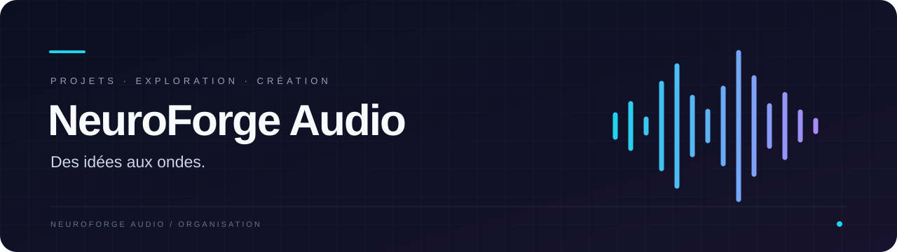
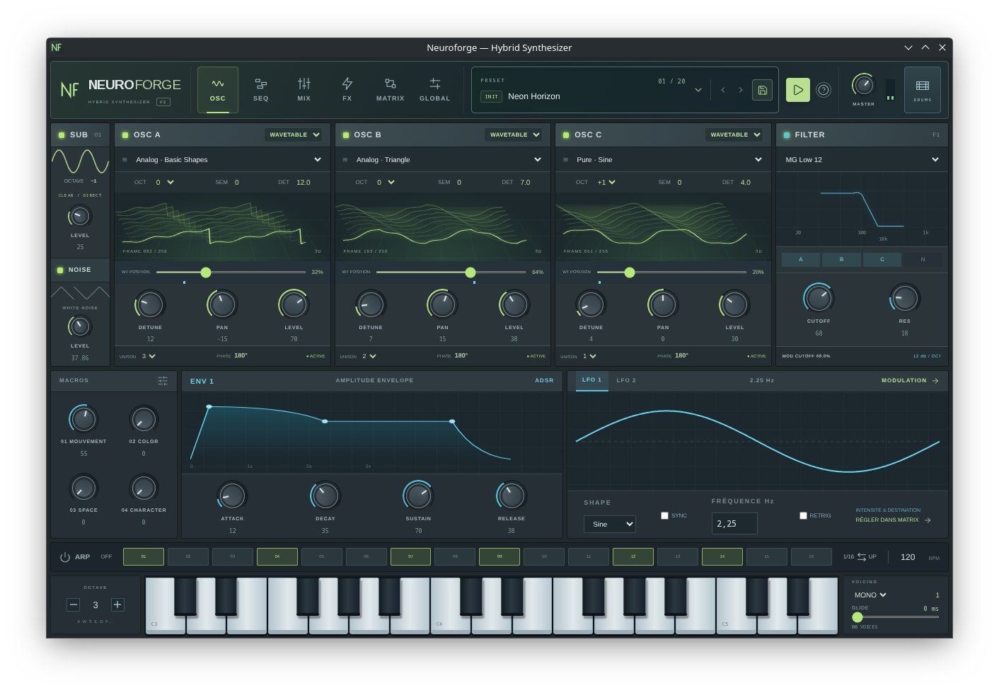

<strong>Un espace pour découvrir nos projets, suivre leur évolution et contribuer.</strong>

  
<!--    -->

 <a href="#nos-projets">Nos projets</a> · <a href="#contribuer">Contribuer</a>

 
## Nos projets

### ◈ NeuroForge — Synthétiseur hybride (BETA)

**NeuroForge** est notre premier projet : un synthétiseur hybride pour explorer et créer des sons, avec des oscillateurs à tables d’ondes, des filtres, des enveloppes et des modulations.

`Synthétiseur` · `Création sonore` · `Version 2.0.1`

#### Télécharger NeuroForge 2.0.1 (BETA)

| Plateforme                      | Téléchargement                                                                                                                                           |
| ------------------------------- | -------------------------------------------------------------------------------------------------------------------------------------------------------- |
| Windows                         | [Télécharger l’installateur (.exe)](https://github.com/neuroforge-audio/neuroforge-audio.github.io/releases/download/2.0.1/Neuroforge-2.0.1.Setup.exe)   |
| Linux — Debian / Ubuntu (amd64) | [Télécharger le paquet (.deb)](https://github.com/neuroforge-audio/neuroforge-audio.github.io/releases/download/2.0.1/neuroforge_2.0.1_amd64.deb)        |
| macOS — Apple Silicon (arm64)   | [Télécharger l’archive (.zip)](https://github.com/neuroforge-audio/neuroforge-audio.github.io/releases/download/2.0.1/Neuroforge-darwin-arm64-2.0.1.zip) |

[Voir la release 2.0.1 →](https://github.com/neuroforge-audio/neuroforge-audio.github.io/releases/tag/2.0.1)

---

### ◇ La suite se construit ici

Les prochains projets seront présentés dans cette section à mesure de leur publication. Retrouvez les dépôts disponibles dans le **[catalogue de l’organisation](https://github.com/orgs/neuroforge-audio/repositories)**.

<!-- Pour ajouter un projet, dupliquer ce bloc et remplacer les champs :
### ◈ Nom du projet

**[nom-du-depot](https://github.com/neuroforge-audio/NOM-DU-DEPOT)**

Une phrase qui explique à qui s’adresse le projet et ce qu’il permet de faire.

`Catégorie` · `Technologie` · `État du projet`

[Explorer le dépôt →](https://github.com/neuroforge-audio/NOM-DU-DEPOT)
-->

## Contribuer

Une idée, une question ou un retour sur NeuroForge ? Rejoignez notre **[espace de discussion](https://github.com/orgs/neuroforge-audio/discussions)** pour échanger autour du projet et participer à son évolution.

Vous pouvez y partager vos impressions sur la bêta, proposer des améliorations, poser vos questions ou signaler un problème. Pour nous aider à comprendre un bug, précisez votre système d’exploitation, la version de NeuroForge et les étapes pour le reproduire.

[Rejoindre la discussion →](https://github.com/orgs/neuroforge-audio/discussions)

Pour contribuer au code, consultez la documentation du dépôt concerné, puis proposez une pull request avec une description claire de votre changement. Les consignes de contribution et les conditions de licence sont à consulter dans chaque dépôt lorsqu’elles sont disponibles.

## Suivre l’aventure

Retrouvez les projets et leur activité sur **[GitHub](https://github.com/neuroforge-audio)**. Pour suivre un projet en particulier, utilisez son bouton **Watch** et choisissez les notifications qui vous intéressent.
